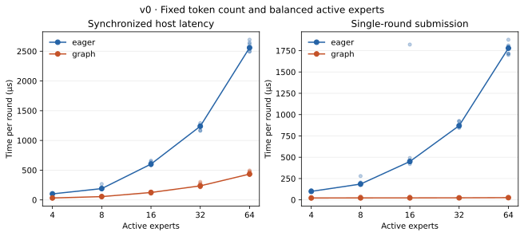
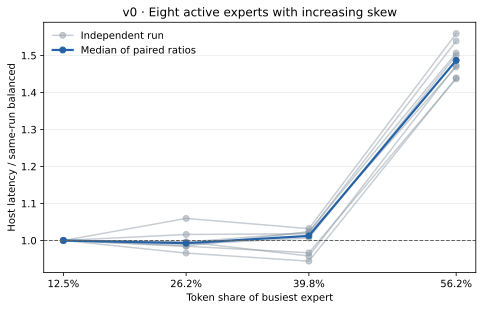

# v0 MoE expert GEMM experiment report

The two controlled experiments separate the effects of active expert count
and load skew on PyTorch v0. With the token count fixed, splitting the
work among more experts raised latency in both the ordinary Python loop
and CUDA Graph replay. Replay submitted each round substantially faster,
while Nsight showed that the finer splits also changed GPU kernel
selection. When eight experts stayed active, light and medium skew were
close to balanced. High skew raised host latency by **48.7%** at the
median of paired runs and doubled the observed GPU kernel count.

## Experimental configuration

| Setting | Value |
| --- | --- |
| Machine | NVIDIA GeForce RTX 2080 SUPER, 8 GiB, compute capability 7.5 |
| Software | WSL2, NVIDIA driver 616.92, Python 3.11.13, NumPy 2.0.1, PyTorch 2.5.1 with CUDA 12.4, Nsight Systems 2026.3.2 |
| Workload | Packed top-1 expert GEMM, `T=256`, `E=64`, `K=N=256` |
| Input control | Identical FP32 `X[256,256]` and `W[64,256,256]`, generated with seed 618. Explicit counts change only expert row offsets. |
| Execution | One CUDA stream, TF32 disabled, preallocated resident GPU buffers, empty experts skipped |
| Work per round | 33,554,432 theoretical FLOP, calculated as `2*T*K*N` |
| Independent runs | Eight fresh processes per experiment. Seeds 101, 202, 303, and 404 select shuffled case orders. Each order is also run in reverse. Experiment 1 reverses the path order within each case as well. |
| Sampling | 20 warmup rounds per case and path, then 30 samples of 20 rounds each, with one synchronization at the end of each batch |
| Validation | CPU FP64 output check with `atol=1e-4` and `rtol=1e-4`. All paths passed. |

The primary metric is synchronized **host latency per expert round**. It
starts before recording the first CUDA Event and ends when the final
Event synchronization returns. Both the host and CUDA Events batch
measurements are divided by 20. Generation, allocation, transfers,
graph capture, correctness checks, and file I/O are outside timing.
Each run reports the median and P90 of its 30 batch averages. Tables
below use the median of the eight run medians. Speedups and skew ratios
are computed within each run before aggregation.

Experiment 1 also collects 30 **single-round submission** samples per
case and path. It times the call until it returns, then synchronizes
outside the interval. This includes Python and framework overhead and
any blocking during submission. Nsight separately traces one warmed
round per case and path, matching GPU kernel records to CUDA API calls
within the case's NVTX range. The trace is diagnostic and is separate
from the latency runs.

## Experiment 1 — Active expert count at fixed total work

The first `A` experts split the 256 tokens evenly. The remaining
`64-A` experts have zero tokens. Each ordinary-loop round therefore
issues `A` calls to `torch.mm`. For the replay path, one CUDA Graph
captures the same round.



| Active experts | Tokens per active expert | Eager host (µs) | Replay host (µs) | Eager submit (µs) | Replay submit (µs) | Paired eager / replay | GPU kernels, eager / replay |
| ---: | ---: | ---: | ---: | ---: | ---: | ---: | ---: |
| 4 | 64 | 101.6 | 32.6 | 99.6 | 22.1 | 3.07× | 4 / 6 |
| 8 | 32 | 190.2 | 55.6 | 185.4 | 23.0 | 3.45× | 8 / 10 |
| 16 | 16 | 602.5 | 124.8 | 449.8 | 23.2 | 4.78× | 32 / 34 |
| 32 | 8 | 1,238.7 | 236.5 | 869.9 | 24.0 | 5.17× | 64 / 66 |
| 64 | 4 | 2,559.0 | 434.5 | 1,778.8 | 26.1 | 5.82× | 128 / 130 |

**Repeated host submission is a measurable optimization opportunity.**
The paired speedup increased from 3.07× to 5.82× as the expert count rose,
while replay submission stayed near 22–26 µs. For a fixed configuration,
the trace showed matching GEMM and reduction kernel names, counts, and
launch dimensions between the two paths. Replay also launched two
auxiliary PyTorch fill kernels. The eager-to-replay gap includes Python,
framework dispatch, and changes in how work reaches the GPU. It does
not measure the cost of an isolated CUDA launch.

**Splitting the GPU work still matters after reducing host submission.**
Replay latency rose from 32.6 to 434.5 µs. Between 8 and 16 active experts,
the GEMM row count fell from 32 to 16 and the observed cuBLAS path
switched to a split-K GEMM followed by a separate reduction. The
ordinary loop's GPU kernel count rose from 8 to 32 at that step.
The experiment also accesses a larger set of expert weights as `A`
increases. The traces establish which kernels ran. They do not quantify
the separate contributions of kernel execution, memory traffic, and
scheduling.

## Experiment 2 — GEMM shape distribution at fixed active count

The first eight experts remain active, the other 56 stay empty, and
every round issues eight `torch.mm` calls. Expert zero receives the
largest share in each skewed case. The balanced case matches the
eight-active-expert configuration in Experiment 1.



| Load | Tokens per active expert | Busiest share | Host median (µs) | Paired ratio to balanced, median (range) | Runs slower than balanced | GPU kernels |
| --- | --- | ---: | ---: | ---: | ---: | ---: |
| Balanced | 8 × 32 | 12.5% | 191.9 | 1.000× | — | 8 |
| Light | 67 + 7 × 27 | 26.2% | 191.1 | 0.993× (0.966–1.060) | 2/8 | 8 |
| Medium | 102 + 7 × 22 | 39.8% | 192.8 | 1.012× (0.944–1.032) | 5/8 | 8 |
| High | 144 + 7 × 16 | 56.3% | 284.6 | 1.487× (1.437–1.559) | 8/8 | 16 |

**The increase was concentrated at the high-skew configuration.** Light
and medium skew stayed within roughly 1% of balanced at the median.
The trace showed the same GEMM kernel family and launch count, with
different grid dimensions for the busiest expert. In the high-skew
case, Nsight recorded a reduction following each of the eight GEMMs,
including the busiest expert's GEMM. This doubled the kernel count
without changing the PyTorch call count. The trace establishes an
execution-path change at the configuration where latency jumped. It
does not establish how much of the increase came from extra launches
or GPU execution.

## Earlier measurements in context

The exploratory sweep covered 72 configurations across token count,
expert count, matrix size, and routing, followed by three shuffled
retests. At 32 tokens, hotspot reduced both active expert count and
host latency for the larger expert pools. At 4,096 tokens with
`E=64` and `(K,N)=(512,1024)`, all experts stayed active and hotspot took
15–26% longer than balanced across retests. An earlier experiment with
eight total and active experts also found that the most skewed load
was slower, by 14.5% at the median paired ratio. Its loop length and
run protocol differed from the new controls.

CUDA Events medians sometimes exceeded host medians in the exploratory
runs, by up to about 9%. This discrepancy recurred after shuffling,
and its cause remains unresolved. This report uses synchronized host
latency for comparisons and keeps CUDA Events as a separate metric.

[Latency by token count](plots/latency_by_tokens.svg) ·
[Latency by active expert count](plots/latency_by_active_experts.svg) ·
[Hotspot versus balanced](plots/hotspot_vs_balanced.svg) ·
[Timer agreement](plots/timer_agreement.svg) ·
[Earlier fixed-active control](plots/fixed_active_comparison.svg)

## Implications for subsequent optimization

1. **Benchmark v1 on these same workloads first.** Compare the C++ cuBLAS
   expert loop against the v0 measurements. Record host submission,
   synchronized latency, and actual GPU kernels. The two implementations
   can select different GPU kernels, so the gap cannot be attributed
   entirely to Python.
2. **Prioritize grouped execution for many small GEMMs.** Compare it
   against v1 on identical buffers, counts, precision, and timing
   boundaries. The 16–64 active expert cases provide a strong test of
   whether batching submission reduces end-to-end latency. Track the
   4- and 8-expert cases too, where grouping overhead has less work to
   offset. Keep graph replay as a diagnostic comparison for reusing fixed
   workloads and buffers.
3. **Use all four skew levels to assess GPU-side scheduling.** Inspect
   whether a grouped or tiled implementation avoids extra reduction
   launches and whether it improves the high-skew case while retaining
   balanced-case performance. Compare actual kernel counts and launch
   dimensions alongside latency. A drop in GPU kernel count and a drop
   in host submission time answer different optimization questions.

## Reproduce the controls

From the repository root, create the environment with
`conda env create -f environment.yml` if needed, activate it with
`conda activate ML`, and run the commands below with Nsight Systems
available on `PATH`.

```bash
(
  set -e
  export OPENBLAS_NUM_THREADS=1 MKL_NUM_THREADS=1
  for experiment in active skew; do
    for seed in 101 202 303 404; do
      output="results/v0/controls/$experiment/seed-$seed"
      python scripts/benchmark_v0_controls.py --experiment "$experiment" --order-seed "$seed" --output-dir "$output-forward"
      python scripts/benchmark_v0_controls.py --experiment "$experiment" --order-seed "$seed" --reverse --output-dir "$output-reverse"
    done
  done
  mkdir -p artifacts/v0_controls_trace
  for experiment in active skew; do
    nsys profile --force-overwrite=true --trace=cuda,nvtx --cuda-graph-trace=node --sample=none --cpuctxsw=none --export=sqlite -o "artifacts/v0_controls_trace/$experiment" python scripts/benchmark_v0_controls.py --experiment "$experiment" --trace
  done
  python scripts/plot_v0_controls.py --trace-dir artifacts/v0_controls_trace
)
```

The timed runs save 3,360 batch samples and 2,400 submission samples under
`results/v0/controls/`, alongside summaries and metadata with the
environment, source commit, source hashes, and execution order. The
plot command validates the measured tables and writes `analysis.json`
and `trace_summary.json` beside them. The figures are written under
`docs/v0/plots/`. The raw timing data and Nsight captures are local outputs
excluded by `.gitignore`.
